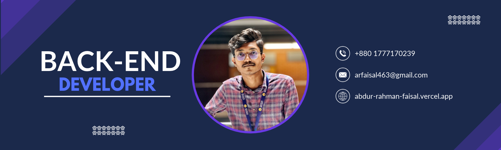

<!--- banner --->

<!-- # 👋 Hi, I'm Abdur Rahman Faisal  
**Backend Developer** | **CSE Undergrad @ Southeast University** --->

    <h1>👋 Hi, I'm Abdur Rahman Faisal</h2>
    <h3>Backend Developer | CSE @ Southeast University</h2>

    
    
    
    

<!--

--->
  

---

### 🛠️ **Technical Toolkit** 

#### **Programming Languages and Database**  

#### **Frameworks**  

#### **Tools & Technology**  

<!--

--->

<!--

--->

###  Core Skills
| **Domain**          | **Expertise**                          |
|---------------------|----------------------------------------|
| ☕ Programming Languages | Java, Python, C, C++, JavaScript, TypeScript |
| 🧠 Data Structures & Algorithms | 200+ DSA problems |
| ⚙️ Backend Development | REST APIs, Authentication, Security, Testing, Deployment |
| ⚛️ Frontend Development | HTML5, CSS, Tailwind, React JS, Vite |
| 🗃️ Database Systems | PostgreSQL, MySQL, MongoDB, Redis |
| 📊 Data Analytics | Python, SQL, Pandas, NumPy, Excel, Google Sheets |
| ⚙️ System Design | REST APIs, Backend Architecture, Database Design |
| 🖥️ Engineering Math | Calculus, Linear Algebra, Statistics, Vector |

---

### 📊 **Coding Activity**  
🌱 Currently Learning: System Design and Cloud Technology
☕ Solved hundreds of LeetCode problems (Easy-Medium-Hard)  
💻 Daily Coding Streak on LeetCode: 40+ days  

---

> *"Turning coffee into code, one bug at a time."* ☕💻
